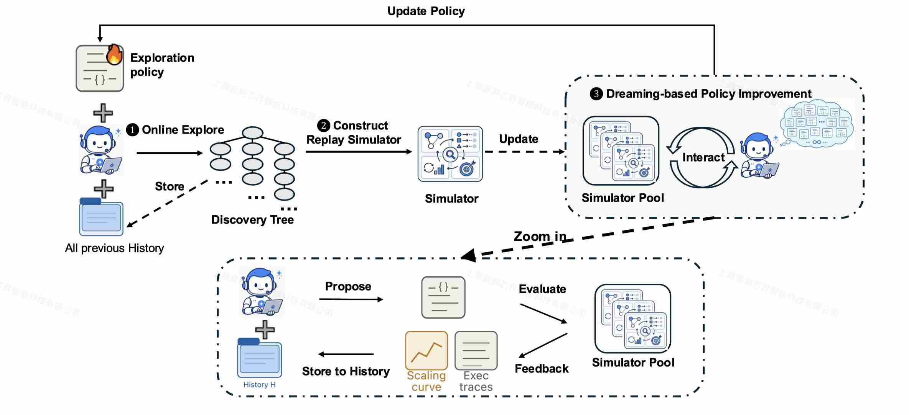

# Dream-RSI: Recursive Self-Improvement through Evolving Worlds

> Tong Zheng, Xidong Wu, Zheng Zhang, Zhankui He, Chaoyi Zhang, Benjamin Coleman, Ruoqiao Wei, Di Bai, Haolin Liu, Rui Liu, Xue Wang, Yue Zhuan, Wang-Cheng Kang, Renkai Xiang, Heng Huang, Xinwu Cheng, Yunsong Guo

> 注：以下论文笔记由 AI Agent 自动生成，可能存在理解偏差或遗漏，请以原论文为准。

## Abstract

Dream-RSI 面向 agent 驱动的长程 discovery：固定探索策略无法利用累积经验，而在线优化探索策略又需要昂贵、延迟的完整 rollout。其核心做法是把历史 discovery tree 转为 replay simulator，在不重复调用 discovery agent 和 evaluator 的情况下回放候选探索策略，再将改进后的策略部署到下一轮真实探索，形成“在线扩展历史、离线优化策略”的闭环。

## 一句话总结

Dream-RSI 不修改底层模型，而是让 agent 的探索编排代码在历史 discovery tree 上低成本试错并递归改进，用 off-policy replay 降低元探索策略优化的在线成本。

## 创新点

1. **可编程探索层。** 将分支、并行 workspace、继续搜索与停止决策从底层 coding agent 中解耦为可执行 policy code，在保持 agent、evaluator 与接口固定的条件下单独优化探索策略。
2. **历史即世界模型。** 把已完成探索中的 proposal、父子关系、执行结果与评分组织成 discovery tree；候选策略可按不同顺序、分支组合和停止条件读取已记录结果，将昂贵的在线元策略评估转为低成本 replay。
3. **在线探索与离线 dreaming 闭环。** 每轮真实探索扩充 simulator pool；固定的 policy-development agent 在历史 worlds 中生成、评估并修订大量策略，再把最佳策略部署到下一轮，实现探索机制本身的递归改进。

## 带来什么提升

1. **算法工程。** 在 Lasso regularization-path discovery 中，Gemini-3.1-Pro 的调用量由固定探索的 550 降至 317，六个 held-out 数据集平均运行时间由 3587.1 ms 降至 2931.0 ms；Gemini-3.7-Flash 则由 3200 次降至 1879 次，平均运行时间由 2516.7 ms 降至 2350.6 ms。
2. **数学优化。** Sum–Difference 达到 1.145427，优于 Recursive Fixed Exploration 的 1.144047；Circle Packing 达到 2.635983，与最强对比结果持平；Autocorrelation 为 1.456375，质量保持竞争力，而总生成量少于 1000，显著低于 SimpleTES 的 51,200。
3. **GPU kernel 工程。** VGG16 与 LayerNorm 在性能相当时分别减少 2.43×、1.79× discovery 成本；ConvDiv 与 ConvMax 在相近预算下分别获得 2.09×、1.44× 更高性能，说明收益来自逐轮改进的资源分配策略，而不只是扩大搜索预算。

## 备注

- 这里的“递归自我改进”发生在 exploration-policy code，而非模型权重、evaluator 或底层 agent；更准确地说，它是受固定外部目标和验证器约束的元探索策略改进。
- replay simulator 只能暴露历史树中已实现的分支及结果，无法可靠估计未被历史策略探索到的动作；因此存在 coverage bias，且论文没有单独报告 replay fidelity、策略跨任务迁移或对 policy-development agent 的系统消融。
- 历史世界可被候选策略反复查询，真实使用时需要独立 online evaluation、保留集和预算匹配，避免对有限 discovery tree 过拟合。
