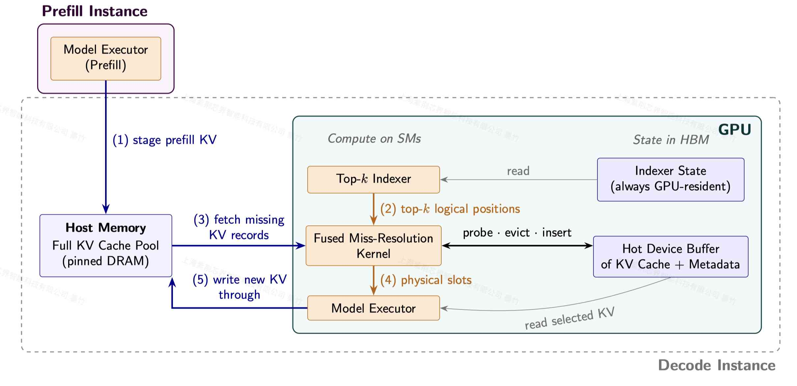

# HiSparse: Scaling Sparse-Attention Decoding with Hierarchical KV Cache Management

> Zhiqiang Xie, Zhangheng Huang, Tingwei Huang, Ziyi Xu, Ruiyang Ma, Christos Kozyrakis

> 注：以下论文笔记由 AI Agent 自动生成，可能存在理解偏差或遗漏，请以原论文为准。

> 来源：[arXiv:2608.07009v1](https://arxiv.org/abs/2608.07009v1)，2026-08-07；[SGLang HiSparse 文档](https://docs.sglang.io/docs/advanced_features/hisparse_guide)。已阅读 20 页正文与附录；实验采用作者实现，未在本地复现。

## Abstract

Top-k sparse attention makes long-context LLM decoding cheap to compute: each step reads only a few thousand selected KV entries rather than the full context. Serving systems, however, typically keep the entire KV cache in GPU HBM so that every position stays selectable, so a request's memory bill still grows with its full context length—decoding hits a capacity wall long before it runs out of compute, and a context whose KV cache exceeds HBM cannot be served at all. We present HiSparse, an exact, indexer-agnostic hierarchical KV cache for sparse-attention serving. HiSparse keeps each request's full KV history in host memory and bounds its decode footprint with a small, fixed-size GPU cache; a fused CUDA kernel resolves each layer's selections—hit detection, LRU replacement, and host-to-device fetches—inside the decode CUDA graph; and, for models that share selections across layers, exact layer-wise prefetching hides roughly half of the remaining miss overhead. Because only KV placement changes, model outputs are unchanged. HiSparse is merged into upstream SGLang and evaluated across three sparse-attention families (DSA, NSA, and Quest) on H200, B200, and GH200 platforms: it improves peak generation throughput by up to 4.7$\times$ on long-context workloads while preserving comparable per-token latency and reducing time-to-first-token at high load—and a no-IO oracle shows that the resolution mechanism itself adds no measurable per-token cost, leaving host–device IO as the only price of bounded residency.

## 一句话总结

HiSparse 把 top-k sparse attention 的“逻辑上随时可选”与“物理上常驻 HBM”解耦：完整 KV 保存在 pinned host memory，每请求每层只保留固定大小的 LRU GPU cache，并在每层 attention 前通过融合 CUDA kernel 精确补齐当前选中集合。

## 创新点

1. **相对特定 sparse attention 算法保持精确。**它不改变 indexer、top-k 位置、attention score 或输出，只把未被当前 step 选中的 KV 放到 host memory。Indexer state 始终留在 GPU，包括 DSA 的 indexer keys、NSA 的 compressed block keys 和 Quest 的 page summaries；每 token 只占数百字节，而 KV record 约 100KB/token。由于接口只消费“逻辑位置集合”，同一套机制可接 DSA、NSA、Quest。
2. **固定容量 GPU cache 与 page table。**每请求每层保留 $B$ 个 KV 槽，要求 $B \ge k$。当前 top-k 必须装入 cache，其余 $B-k$ 槽保留近期仍可能复用的条目；decode HBM 从 $N_{batch}N_\ell L_{ctx}W_{KV}s$ 降为近似 $N_{batch}N_\ell B W_{KV}s$。GLM-5.1 在 128K 时单请求完整 KV 为 13.09GB，$B=4096$ 时约 0.4GB，约 30× 缩减，但新增 host-memory 和传输成本。
3. **融合 RESOLVE kernel 把命中判定、LRU 替换和 H2D 补齐放进 decode CUDA graph。**一个 CUDA block 处理一个请求：构建 top-k 的 shared-memory hash table，并行标记 cache 槽命中/可替换，扫描并选择 victim，用 GPU thread 直接对 pinned host memory 发 `ld.global.nc.v2.b64` 读取，最后输出按 top-k 顺序排列的 device slots。它类似软件管理 TLB，避免每层多次 kernel launch 和将中间 metadata 写回 HBM。
4. **共享 indexer 时做精确跨层 prefetch。**在 IndexCache / GLM-5.2 IndexShare 一类模型中，anchor layer 的 top-k 决定随后若干共享层的同一选择。HiSparse 在 anchor RESOLVE 时记录 miss plan，由 side stream 将记录提前复制到共享层 cache，并复用 slot table 与 completion event，跳过共享层的 resolve。普通模型若用上一层选择推测下一层，只带来浪费传输，实验未看到端到端收益。

## 带来什么提升

1. **长上下文峰值吞吐：**在 H200/B200/GH200 上，最显著结果为 Qwen3-30B-A3B + Quest 在 GH200、200K context 下达到 **4.7×**（111→520 tokens/s）；GLM-5.1-FP8 + DSA 在 8×H200、160K context 下为 2.9×（232→680 tokens/s），32K 下 3.1×；DeepSeek-V4-Flash + NSA 在 2×B200、concurrency 64 下从 600 提升到 1,257 tokens/s，即 2.1×，decode-only 代理指标为 2.9×。收益来自同一 HBM 中容纳更大 decode batch，低频/短上下文下会消失。
2. **容量可换取更大 batch 或更少 HBM：**GLM-5.1 在约 60 请求、32K 上下文的 decode KV 从约 240GB 降到约 25GB（$B=4096$）；匹配 batch 时释放 HBM，未匹配时则提高并发。论文还指出超长上下文原先可能因 HBM 不足完全无法 admission，层级放置把可服务上限转成 host-memory capacity 上限。
3. **选择局部性可被执行：**LongBenchV2 100K-token GLM-5.1 trace 显示，只保留当前 top-k（$B=k$）平均 miss 30%；$B=2k$ 的 LRU miss 为 **13.4%**（约 87% hit），优于 FIFO 17.2%、随机 16.1%，并接近 Belady 的 8.2% 趋势。$B=4k$ 进一步将 LRU miss 降到 6.7%。
4. **共享 indexer 时 IO 可被隐藏：**GLM-5.2、32K/8K、8×H200、$B=4096$ 下，exact prefetch 相对同步 resolve 在匹配并发降低 TPOT **13%–15%**、提高吞吐 **14%–17%**；峰值从 baseline 618、无 prefetch 1,515 提高到 1,727 tokens/s，约为 full-KV baseline 的 **2.8×**。no-IO oracle 为 2,034 tokens/s，因此 exact prefetch 达到理论上界的 85%；oracle 的 resolve 与 baseline TPOT 接近，说明主要剩余代价是 host IO 而非 kernel 逻辑。

## 备注

- **不是零成本卸载：**同步 miss 在低并发约增加 **7–8ms/token** TPOT；高 batch 时多个请求争同一 host 链路。Exact prefetch 仅对共享选择模型成立，并仍留下 anchor layers 的同步 IO。GPU-assisted IO 采用 Strata 风格，不等同于 GPU-initiated NVMe。论文的 no-IO oracle故意返回 stale KV，只用于测性能上界，不能当作正确输出。
- **适用性取决于第二层容量和链路：**主要收益要求 host DRAM 明显大于 decode HBM；GB200/GB300 等 Grace 系统上 CPU LPDDR 与配对 GPU HBM 相近甚至更小，收益受限。短上下文、低并发或工作集可完全驻留 HBM 时应关闭 HiSparse。$B$ 是静态部署参数，论文测试 $B\in[2k,4k]$，更快的 NVLink-C2C 使较小 cache 更有吸引力；动态 resize 留作未来工作。
- **实验边界：**没有物理 PD-disaggregated 集群实验，decode-only 曲线只是代理；主实验为 BF16 KV、k=2048，DeepSeek-V4-Flash 的 top-512 压缩条目覆盖 2,048 tokens。推理集成在 SGLang v0.5.11 上游，约 2,200 行 Python 加 CUDA kernel；pipeline parallelism 或 speculative decoding 下会退回同步 swap-in。与 HiCache 互补：前者管 prefix 跨请求复用，HiSparse 管活跃请求的 decode working set。
- **与其它 KV 工作的区别：**它不做 KV eviction/quantization 来改变质量，而是精确保留完整 host copy；相比 ESS 的架构特化与 ECHO 的预测 prefetch，它强调 indexer-agnostic、LRU locality 和模型共享 index 时的 exact prefetch。对统一 lifecycle optimizer 的启发是：selector 输出本身就是下一次 KV 访问计划，但应区分 demand miss 与 prefetch，并把 host-link、batch contention、cache size 和 host capacity 共同纳入 cost model。
