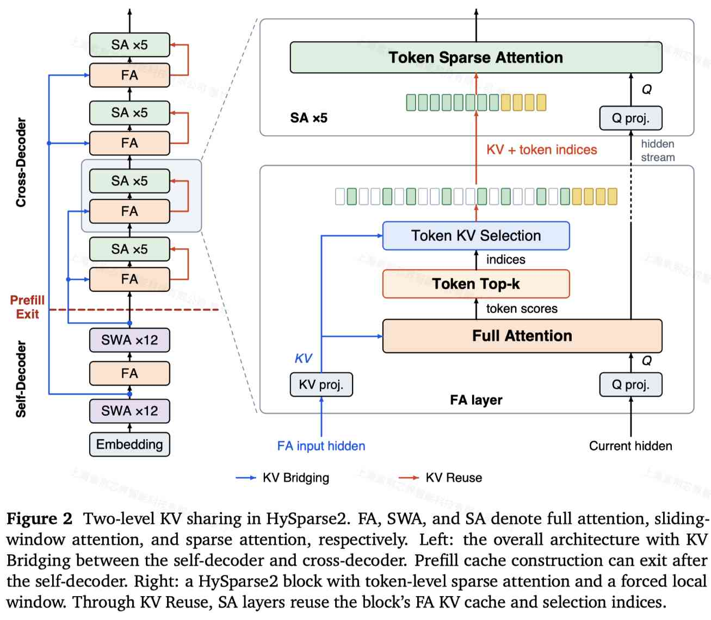

# HySparse2: Hybrid Sparse Attention with Two-Level KV Sharing

> Jianyu Wei, Yizhao Gao, Qihao Zhang, Shimao Chen, Zhengju Tang, Yu Cheng, Shengjie Zhou, Zihan Jiang, Yifan Song, Hailin Zhang, Liang Zhao, Bo Yang, Gang Wang, Shijie Cao, Fuli Luo

> 注：以下论文笔记由 AI Agent 自动生成，可能存在理解偏差或遗漏，请以原论文为准。

> 来源：[arXiv:2609.26368v1](https://arxiv.org/abs/2609.26368v1)，2026-09-22，LLM-Core, Xiaomi。以下结果来自论文正文及消融实验。

## Abstract

Long-horizon and multi-turn agents typically generate short actions and process long observations from tools and environments. This growing context demands efficient prefill, compact KV-cache storage, and accurate long-context retrieval. To meet these demands, we introduce HySparse2, a hybrid sparse attention architecture with two-level KV sharing. At the outer level, KV Bridging adopts a YOCO-style self-decoder and cross-decoder structure, but bridges only full-attention layers. The self-decoder uses hybrid sliding-window attention (SWA), while the cross-decoder uses hybrid sparse attention. The KV caches for full-attention layers in the cross-decoder are generated from the hidden states of full-attention layers in the self-decoder. At the inner level, HySparse2 retains HySparse's core KV Reuse design with two refinements. First, it replaces block-level sparsity with token-level sparsity for finer long-context retrieval. Second, it removes the separate SWA branch from sparse layers and instead forces a sliding window of recent tokens into the sparse selection. This two-level KV sharing allows all cross-decoder KV caches to be constructed from self-decoder hidden states. Prefill can therefore exit after the self-decoder, skipping all cross-decoder layers. On an 80B-A3B MoE model, HySparse2 outperforms HySparse and Hybrid SWA on long-context retrieval and multi-turn agentic tasks, while substantially reducing prefill computation and KV-cache storage.

## 一句话总结

HySparse2 将 HySparse 的块内 KV/索引复用与 YOCO 式前后半段解码器结合，通过全注意力层之间的 KV Bridging、token 级稀疏选择和共享局部窗口，使长输入 Agent 的 prefill 缓存构建可在前半段模型结束，并改善长上下文检索。

## 创新点

1. **外层 KV Bridging：从前半段隐藏状态构建后半段缓存。** self-decoder 使用 full attention + sliding-window attention（SWA），cross-decoder 使用 full attention + sparse attention。只连接两部分中的 full-attention 层：后半段每个目标层用独立的 K/V 投影处理对应前半段层的输入隐藏状态，Q 仍来自目标层当前隐藏状态。多个目标层可以共用隐藏状态来源，但各自生成不同 KV；不是所有层只共享同一份 KV。
2. **内层 KV Reuse：把 64-token block 选择改为 token 选择。** 每个 full-attention 层利用实际 attention 分数选取 1,024 个全局 token，后续 sparse 层复用该层 KV 与选择索引，无需单独训练或蒸馏 indexer。细粒度预算能覆盖分散在多轮工具输出和角色边界中的证据，避免为少数重要 token 带入整个相邻块。
3. **强制局部窗口解除后半段的缓存依赖。** sparse 层不再保留独立投影的 gated SWA 分支，而是把最近 128 个 token 强制并入选择集合，与全局 token 使用同一 full-attention KV。这样无需为后半段 SWA 逐层递推计算越来越长的 token 后缀，prefill 缓存构建可以跳过整个 cross-decoder。49 层配置只需部署前 25 层及 Bridging 投影到 prefill 节点；decode 仍执行完整模型。

## 带来什么提升

1. **长上下文检索：**80B-A3B MoE 经约 500B tokens、32K 上下文预训练，再以相同数据配方做约 100B tokens、256K 上下文轻量后训练后，相比 HySparse，MRCR-v2 和 RULER-v2 跨长度等权平均分分别提高 **11.30、19.81 个百分点**；相比 Hybrid SWA 分别提高 6.44、18.65 个百分点。256K RULER-v2 为 **58.45**，两基线为 32.61、35.74；在所测长度内 AgentPPL、LongPPL 也均更低（§4.1–4.2，图 3）。
2. **Prefill 计算和缓存：**80B-A3B、1M tokens、FP8 KV 的成本分析中，prefill FLOPs 分别为 HySparse、Hybrid SWA 的 **1/2.92、1/5.02**；KV 为 **2.69 GB**，两基线为 6.72、12.09 GB，约少 **60.0%、77.8%**。这些是 FLOPs/存储比较，论文未据此报告实测 TTFT、吞吐或任务墙钟加速（§4.2，图 4）。
3. **细粒度选择的独立收益：**相同 backbone、1,024 个全局 token 预算和独立 128-token 局部窗口下，token 选择相对 64-token block 选择，在预训练后、32K 以内将 RULER-v2、双针 MRCR-v2、GraphWalks 分别提高 **6.57、8.14、5.55 个百分点**（表 3）。290B-A8B、约 1.8T tokens 的 Bridging 消融中，LongPPL 从 3.6053 降到 3.4202，其他任务总体接近但有升有降（表 5）。

## 备注

- **配置与归因：**主实验均为 49 层、hidden size 2,048，但 HySparse2 用 MQA（64/1 个 Q/KV heads，QK/V 维度 256/256），HySparse 和 Hybrid SWA 用 GQA（64/4，192/128）；full-attention 层数分别为 5、5、9。因此总体显存/FLOPs 差异不能全部归因于两级共享。完整方案通用能力也并非全面提升，例如预训练 DROP 低于 HySparse。
- **局部窗口有质量取舍：**Forced SWA 对比 Gated SWA，RULER-v2 和 GraphWalks 更好，但 GSM8K、MRCR-v2 分别低 5.08、4.99 个百分点，LongPPL 高 1.50%（表 4）。检索质量验证到 256K；1M 是成本分析。AgentPPL 为内部 1,000 条轨迹上的 byte perplexity，不能直接等同于真实 Agent 任务成功率。
- **系统启发与开放项：**KV 恢复/重算代价应按架构实际依赖图计量，共享缓存还需追踪各消费层；token 级稀疏可能增加分页读取放大。论文提出 boundary hidden state 接 DFlash 式 drafter、异步草稿/验证，但仍属后续工作。论文未提供专用代码链接，元数据仅关联已收录且直接比较的 HySparse；Hybrid SWA 不映射为库中另一篇名为 SWA 的训练论文。
