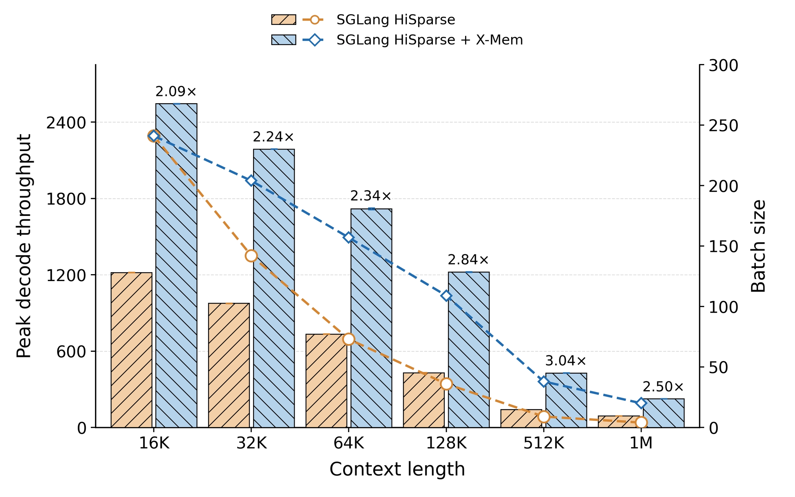

# XM-Sparse: Pushing the Throughput Frontier of Sparse Attention with Netpreme X-Mem

> Netpreme Team · 2026-10-19 · 官方工程博客，当前未找到独立 arXiv 论文。

> 注：以下技术笔记由 AI Agent 自动生成，可能存在理解偏差或遗漏，请以原文为准。

> [官方原文](https://netpreme.com/blog/xm-sparse-sglang-hisparse-netpreme-xmem) · [用户提供的中文解读](https://mp.weixin.qq.com/s/1-RMbaar72dJh-JaIRKxlA)。已阅读官方全文并核对图 6；微信正文受环境验证限制，以下以官方文章为依据。封面为官方图 6，仅用于说明原文实验结果。

## Abstract

XM-Sparse 将 Netpreme X-Mem 外部内存层接入 SGLang HiSparse：GPU HBM 保留热 KV buffer 和 indexer key cache，完整 KV 历史保存在外部内存，decode 只回读被选中且未命中的 KV。文章以高带宽访问改善相同 batch 的 decode 延迟，并以更大容量提高长上下文的可行并发量。实验使用 X-Mem Pilot VM，通过额外 GPU 的 HBM 模拟未来内存节点，尚非量产 X-Mem 芯片测量。

## 一句话总结

XM-Sparse 保留 HiSparse 的稀疏选择和热缓存机制，将完整 KV 的外部存储从主机 DRAM/PCIe 路径换成 scale-up fabric 上的 GPU 可寻址内存节点，联合缓解 miss 回读带宽与完整历史容量瓶颈。

## 创新点

1. **稀疏读取与完整存储分离。**动态 top-k 每步可能变化，因此不能只保存当前被选中的 KV。设计目标是在 HBM 中保留 4,096-token/layer 热 buffer 和 K-index，将完整历史放入独立内存节点；文中建模每步选择 2,048 个 KV entries/layer，只为 hot buffer 未命中的部分支付外部访问成本。
2. **接入独立扩展的 X-Mem 节点。**官方架构描述为每节点 4 个 MPU、最多 24 TB DDR5、约 4 TB/s 聚合带宽，供机架 GPU 共享；GPU 通过兼容 CUDA/PyTorch 的地址/API 访问。集成保留 HiSparse 的选择、缓存管理和预取机制，并支持 decode 与 selected-KV fetch 的 CUDA Graph capture/replay。文中 900 GB/s 是分析模型的每 GPU 带宽假设，不等同于已交付芯片上的实测 KV 吞吐。
3. **按请求生命周期管理共享历史。**prefill GPU 直接发布 prompt KV；decode 从热 buffer 或 X-Mem 取选中 KV，每个成功 decode step 后将新增 KV 写回历史。公共 prefix 可共享，owner 创建内存区域，各 GPU 进程通过 descriptor attach；所有进程 detach 后才释放物理区域，请求结束也须等待未完成访问后回收。

## 带来什么提升

1. **相同 batch 的 TPOT：**GLM-5.3、4 张 B300 decode GPU、attention DP4 + MoE EP4、16K context、batch 192/GPU、关闭预取时，20% top-k miss 下平均 TPOT 从 **167.48 ms 降到 84.99 ms，降低 49.25%**；40% miss 下从 **255.69 ms 降到 93.13 ms，降低 63.58%**。这里 miss 指已选中的 KV 未在 GPU 热 buffer 命中的比例，不能解释为全上下文稀疏率。小 batch 收益很小，也可能略慢（官方图 5）。
2. **各自最佳测试 batch 的峰值吞吐：**固定 20% miss、关闭预取，16K/32K/64K/128K/512K/1M 上下文相对 host DRAM 分别为 **2.09x/2.24x/2.34x/2.84x/3.04x/2.50x**。指标是每 GPU output tokens/s；16K 两者均为 batch 241/GPU，主要体现访问路径收益；更长上下文还包含更大容量允许更大 batch 的收益，不是等并发、等容量比较（官方图 6）。
3. **模型区分带宽与容量：**4-GPU instance 的 host DRAM 预算为 1 TB，expanded memory 为 24 TB。128K 下 1 TB 配置最多 batch 36/GPU，24 TB 配置到 109/GPU；在后者 batch 上，900 GB/s 模型相对 64 GB/s 的吞吐为 1.39x。1M 下仅将容量从 1 TB 扩到 24 TB、带宽同为 64 GB/s，就使可行 batch 从 4 到 20/GPU，并得到 2.34x 的建模吞吐。这些是测得 compute time 加估算 I/O 的模型结果，与 Pilot VM 图 6 的测量口径不同。

## 备注

- **实验平台边界：**4 张 B300 执行 decode，额外 4 张 B300 的 HBM 充当 memory banks，走未来芯片将暴露的访问路径；24 TB 是容量预算，batch 上限按容量模型确定，不能认为物理 bank GPU 实装了 24 TB DDR5。官方明确 X-Mem silicon 后续才会提供；未报告生产芯片的功耗、成本或总 GPU 成本归一化收益。
- **工作负载边界：**使用 synthetic KV prefixes、固定 20%/40% miss，评测关闭预取；因此未证明真实 Agent trace 下的动态 miss、prefetch/compute overlap、多 GPU 共享 fabric 竞争、尾 TPOT/SLO 或完整任务墙钟收益。理论模型假设每 GPU 持续获得标称带宽，且 compute 与 I/O 不重叠，小 batch 和共享带宽下降时结论可能改变。
- **对 KV cost model 的启发：**分别测同 batch 的带宽收益与放宽容量后的并发收益，用实际 selected-miss bytes、有效共享带宽、队列/同步、write-back 和 compute-overlap 估计恢复成本；把公共 prefix 的生命周期、映射引用和未完成访问纳入回收约束。当前材料为官方博客，已按用户要求创建 `meta/2026/XM-Sparse.prototxt`，以 `Blog` 标记来源并接入站内索引。
